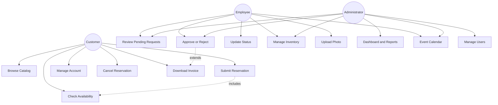
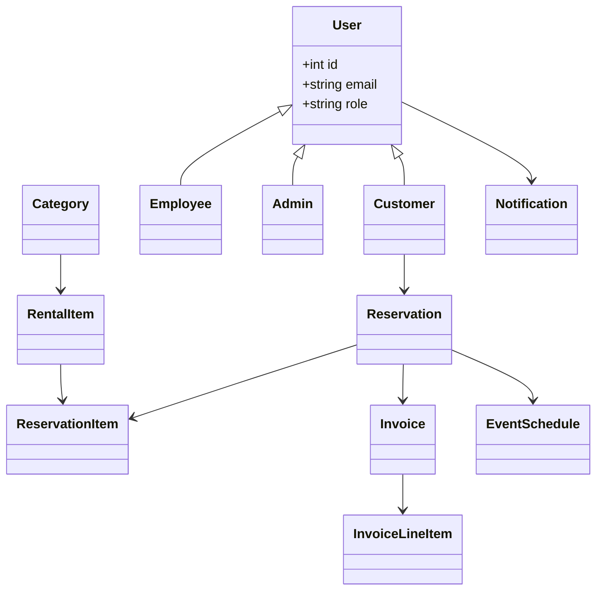

# Struga Events — Rental Management System

**SOUTH EAST EUROPEAN UNIVERSITY**  
Faculty of Contemporary Sciences and Technologies  

**Course:** Software Engineering · **Semester:** 6, 2026  

**PROJECT TITLE:** Struga Events — Rental Management System  

**Student:** Drilon Merko · **Mentor:** Mentor Hamiti  

**May 2026, Tetovo**

---

## Table of Contents

1. [Project Outline](#1-project-outline)  
2. [User Stories](#2-user-stories)  
3. [Use Case Diagram](#3-use-case-diagram)  
4. [Class Diagram](#4-class-diagram)  
5. [Software Architecture](#5-software-architecture)  
6. [Design and Implementation](#6-design-and-implementation)  
7. [Testing](#7-testing)  
8. [Evolution](#8-evolution)  

---

## 1. Project Outline

### Problem Statement

Event rental businesses in Struga and the Lake Ohrid region manage operations with paper ledgers, phone calls, and spreadsheets. This causes double-bookings, poor inventory visibility, slow invoicing, and no real-time availability for customers.

### Proposed Solution

**Struga Events** digitizes equipment rental: customers browse tents, tables, chairs, decorations, and lighting; check availability; submit requests online. Staff approve bookings, track inventory, generate invoices, and view the event calendar.

### Target Users

- Event rental owners and managers  
- Employees (booking agents, warehouse)  
- Customers  

### Goals

- Eliminate double-bookings  
- Real-time inventory  
- Simplified invoicing  
- Customer self-service portal  
- Centralized event calendar  

---

## 2. User Stories

### Customers

- Browse rental items with descriptions and prices  
- Select dates and see availability  
- Submit reservation requests (multi-item cart)  
- Account with active/past reservations  
- Confirmation and invoice when approved  
- Cancel pending reservations  

### Employees

- View and approve/reject pending requests  
- Verify availability before approval  
- Auto invoice on approval  
- Update reservation status (active, completed)  
- Manage inventory, prices, and photos  

### Administrators

- Dashboard: events, inventory, revenue  
- FullCalendar event view  
- Manage users and roles  
- Revenue and usage reports  

---

## 3. Use Case Diagram

---

## 4. Class Diagram

*Implementation: `users.role` implements Customer / Employee / Admin; tables match domain classes.*

---

## 5. Software Architecture

### 5.1 Three-tier client-server

Presentation (HTML/CSS/JS) → Application (PHP) → Data (MySQL).

### 5.2 Frontend

HTML structure, CSS responsive layout, JavaScript for catalog, cart, availability, FullCalendar on admin panel.

### 5.3 Backend

PHP: authentication, reservations, conflict detection, invoices, notifications, reports, uploads.

### 5.4 Database

MySQL — `sql/schema.sql`.

### 5.5 File Storage

`uploads/` for item photographs (JPEG/PNG, max 5MB).

---

## 6. Design and Implementation

### 6.2 Main tables

| Table | Purpose |
|-------|---------|
| users | All roles |
| categories | Tents, Tables, Chairs, etc. |
| rental_items | Catalog, stock, deposit, photo |
| reservations | Bookings and status |
| reservation_items | Line items |
| invoices | Billing |
| invoice_line_items | Invoice details |
| event_schedule | Calendar |
| notifications | Alerts |

### 6.3 UI areas

1. Public catalog + cart + checkout  
2. Customer dashboard  
3. Employee/admin panel  
4. FullCalendar + reports (admin)  

---

## 7. Testing

See **`TESTING.md`** for cases T01–T20.

---

## 8. Evolution

### Strengths

Responsive UI, availability checking, invoices, RBAC, core user stories.

### Planned (v2+)

Email, online payments, Leaflet delivery map, multilingual UI, mobile app, public API.

See **§8.3–8.4** in the original course document for the full roadmap.

---

*Implementation: standalone project `StrugaEventsRental/` — Drilon Merko, SEEU 2026.*
